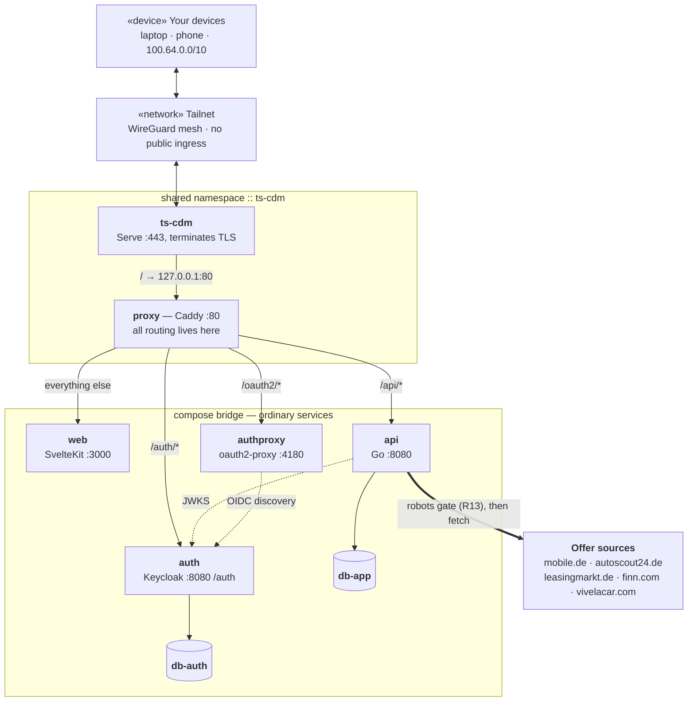
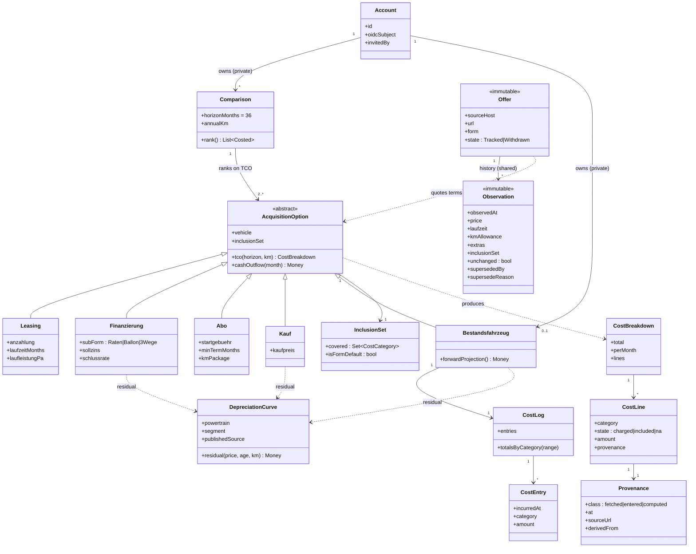
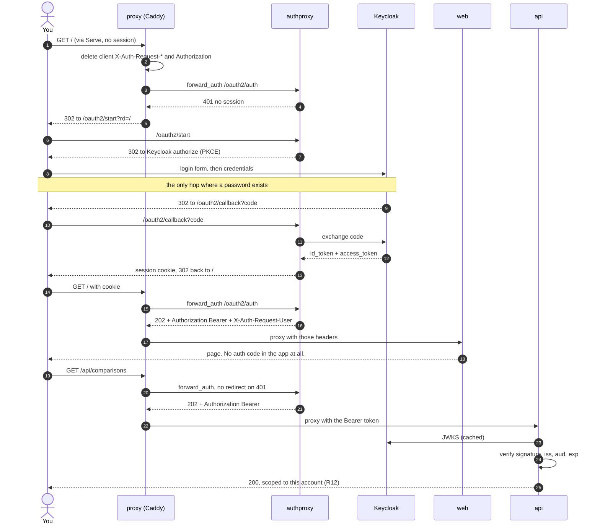
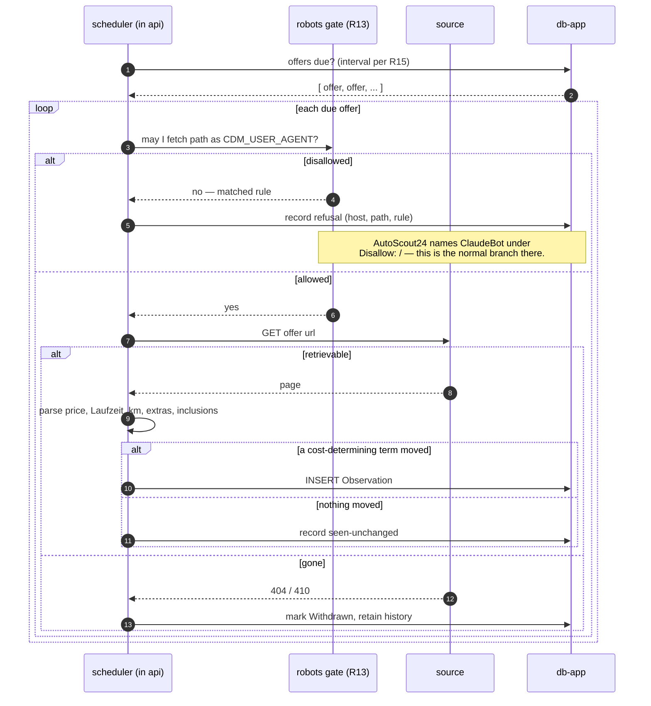
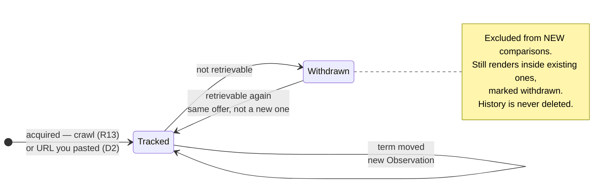

# Architecture

The agreed design, drawn. Companion to `REQUIREMENTS.md` (what is built) and
`docs/concepts.md` (what the terms mean); this file is *how the pieces sit
together*.

**Status: agreed topology, not an implementation.** `api/` and `web/` do not
exist. Everything here is the ARC1 discussion made concrete so it can be
reviewed before code exists, not a description of running software.

Rendered version with the same content:
<https://claude.ai/code/artifact/a48a85f1-4d9e-4d05-ba0b-bcf4408c4d4c>

---

## 1. Deployment topology

Eight services. Tailscale Serve terminates TLS and hands everything to Caddy;
Caddy does all the routing. **No service declares `ports:`** — nothing is
published on a host interface.

The only route in is a WireGuard tunnel; the only route out is the robots-gated
fetcher.

### Why exactly one container shares a namespace

Tailscale Serve can only proxy to `127.0.0.1` — a documented, deliberate
limitation. So *something* must sit inside the sidecar's network namespace.
That something is **Caddy, and nothing else**.

An earlier draft put `web`, `api` and `auth` in there, which forced hand-managed
port allocation in a flat space and displaced Keycloak to 8081. Putting a proxy
there instead means every other service keeps its natural port, is reached by
DNS name, and **adding a service is a Caddyfile block with no namespace surgery
and no `cdm.json` edit**. See `docs/compose.md` §3.

What has not changed: the namespace trick is still load-bearing. Moving `proxy`
onto ordinary bridge networking breaks Serve, and therefore TLS, in a way that
presents as a certificate problem rather than a topology one.

### The header chain

Two proxies now sit in front of Keycloak, so `trusted_proxies static
127.0.0.1/32 ::1` in the Caddyfile is load-bearing. Serve sets
`X-Forwarded-Proto: https`; without that directive Caddy overwrites it with
`http` from its own plain connection, Keycloak builds `http://` redirects, and
login loops. `docs/compose.md` §4 draws it.

### One hostname (D24)

Keycloak lives at `/auth` under the single `cdm.<tailnet>.ts.net` rather than
having a hostname of its own — one auth key, one certificate, one node. The
issuer is `https://cdm.<tailnet>.ts.net/auth/realms/cdm`, so relocating Keycloak
later means reissuing every token: a migration, not a config change.

### Authentication at the ingress (D31, D32)

`authproxy` (oauth2-proxy) runs against Keycloak and **gates every request**
through a reusable Caddy `(sso)` snippet. An unauthenticated browser is
redirected to Keycloak before it reaches any application container, so
**CDM's own `web` runs no OIDC flow at all** and a future service gets the same
treatment with `import sso` and no auth code of its own.

`api` still verifies the Bearer token oauth2-proxy supplies — signature, issuer,
audience, expiry — rather than trusting an identity header, because every
container on the compose bridge can reach `api:8080` directly. §5 draws the
whole flow.

### Why two Postgres instances

Keycloak's schema is entirely its own. Splitting means the application database
can be dumped, restored or reset without touching identity. Costs roughly 50 MB
of RAM — collapse to one instance with two databases if the host is tight.

---

## 2. Tailscale — what it is and how this is reached

### The concept

A mesh VPN built on WireGuard. The important difference from a conventional VPN
is that **there is no central server your traffic flows through**. Tailscale
splits into:

- a **control plane** — Tailscale's coordination server, which knows which
  devices are yours and exchanges their public keys;
- a **data plane** — direct, encrypted tunnels between your own devices.

Tailscale's servers are a phone book, not a pipe. They never see your traffic.

### The tailnet

Every device logging in with your account joins one private network, the
*tailnet*. Each gets a permanent address in `100.64.0.0/10` that does not change
with the WiFi you are on. **MagicDNS** layers names over the top, giving
`cdm.<tailnet>.ts.net` instead of a memorised IP.

### Why no port forwarding is needed

Most machines sit behind NAT. Tailscale hole-punches to establish a direct
connection; where that fails — strict corporate NAT, CGNAT — it relays through
DERP servers, still encrypted end to end so the relay cannot read it.

Practically: the docker host sits on an ordinary home LAN behind an ordinary
router with **no port forwarding, no public IP, no dynamic DNS, and no firewall
rules**.

### Tailscale Serve — the piece this design leans on

Serve takes a local port and publishes it *on the tailnet* over HTTPS with a
**real, publicly trusted TLS certificate** for the `*.ts.net` name. Tailscale
controls that DNS, so provisioning from Let's Encrypt is automatic. The result
is a genuine padlock on a private network — normally that requires running an
internal CA and installing a root certificate on every device.

That is not cosmetic here. Keycloak in production mode requires HTTPS, and OIDC
is strict about secure cookies and exact redirect URIs. Real certificates delete
that entire category of problem.

> **Funnel** is Serve's sibling and publishes to the *public internet*. It is
> not used. SEC1 in `CLAUDE.md` names enabling Funnel as one of exactly two
> changes that would create an exposure — the other being adding `ports:` to any
> service.

### Access runbook

1. In the Tailscale admin console, enable **MagicDNS** and **HTTPS
   Certificates**. Serve will not issue certificates without both.
2. Generate **one** auth key, tagged `tag:cdm`. **Ephemeral must be OFF** — an
   ephemeral node disappears on restart and takes its certificate with it.
3. Copy `.env.example` to `.env` and fill in the key, the tailnet name, and the
   database passwords.
4. `docker compose up -d`, then allow roughly 60 seconds for DNS propagation and
   certificate provisioning.
5. Install Tailscale on your laptop and phone; log in with the same account.
6. Open `https://cdm.<tailnet>.ts.net` — identical from home, mobile data, or
   another country.

Keycloak's admin console is at `https://cdm.<tailnet>.ts.net/auth/admin`.
All of it is served through Caddy; Serve only ever sees `127.0.0.1:80`.

The host itself never installs Tailscale. It runs *inside* the sidecar
container.

### Two gates, not one

Tailnet membership is the outer gate; Keycloak is the inner one. Someone without
tailnet access does not reach a login page — there is no route to the machine
at all.

---

## 3. Domain model

The five acquisition forms are subtypes of one thing, because ranking them
against each other only works if they are one thing. `Bestandsfahrzeug` is a
peer of the other four, not a special case bolted to the side.

Ownership from `Account` is the privacy boundary of R12: everything hanging off
it is private, while `Offer` and its `Observation` history are shared across all
accounts.

### Three invariants, all of them settled by verdict

- **Offer and Observation are immutable, but supersedable** (D28). A price
  change appends rather than updates — the only reason "tracked for changes" is
  answerable. A mis-parse is marked *superseded* with a reason, dropping out of
  charts, comparisons and change detection without ever being deleted. The
  database only ever grows.
- **InclusionSet is a per-form default with a per-offer override** (D29). An
  override may be typed as readily as parsed. An option still carrying an
  unoverridden default is marked *assumed*, because German Abo bundles genuinely
  differ between providers — the marking makes that risk visible, it does not
  remove it.
- **CostLine carries Provenance, and nothing displays it** (D27). Provenance is
  per-figure because one comparison mixes scraped prices, typed overrides and
  curve output in a single column. It is recorded for debugging and audit only;
  no screen depends on it, so surfacing it later is purely additive.

---

## 4. Cost category matrix

The mechanism that makes an Abo rate and a purchase price comparable. The same
eleven categories apply to every form; what differs is whether each is
*charged*, already *included* in the rate, or *not applicable*.

| Cost category | Leasing | Finanzierung | Abo | Kauf | Bestand |
|---|---|---|---|---|---|
| Anschaffung — price, Anzahlung, Überführung | charged | charged | charged | charged | n/a |
| Finanzierungskosten — interest only | n/a | charged | n/a | n/a | n/a |
| Wertverlust | n/a | charged | n/a | charged | charged |
| Kapitalkosten | charged | charged | charged | charged | charged |
| Kfz-Steuer | charged | charged | *included* | charged | charged |
| Versicherung | charged | charged | *included* | charged | charged |
| Wartung und Verschleiß | charged | charged | *included* | charged | charged |
| Reifen | charged | charged | *included* | charged | charged |
| HU / AU | charged | charged | *included* | charged | charged |
| Energie — Kraftstoff / Strom | charged | charged | charged | charged | charged |
| Mehrkilometer | charged | charged (3-Wege) | charged | n/a | n/a |

The *included* cells in the Abo column are the **form default** — what an Abo
offer is assumed to cover unless that specific offer says otherwise (D29). An
option still on the default is marked *assumed* rather than confirmed.

**The eleven are fixed as the comparison set.** A user may define extra
categories for the **Cost Log** (D25), but they never become columns in a
ranking: nothing quotes a user-invented category on a leasing offer, so it could
only ever be *charged* or absent — never *included* — and an option that cannot
express all three states is not comparable with one that can. User categories
roll up into the Bestandsfahrzeug's totals instead.

**Energie is charged in every column.** No provider in this market includes fuel
or charging, so it is always the driver's cost. Getting this wrong is the single
easiest way to make an Abo look cheaper than it is.

---

## 5. Sign-in sequence

**The application runs no OIDC flow.** Caddy gates every request through
oauth2-proxy; an unauthenticated browser is redirected before it ever reaches
`web`. What arrives at the application is already authenticated.

**Two independent checks, deliberately (D32).** Caddy decides whether a request
may proceed; `api` separately verifies the token's signature. The tempting
simplification — have `api` trust `X-Auth-Request-User` and skip verification —
was rejected because **every container on the compose bridge can reach
`api:8080` directly**, and Caddy is not in that path. Under header-trust, one
stray `ports:` line or one compromised container would be a silent, total
bypass.

**Two details that matter:**

- Step 2 is the security-critical one. Caddy **deletes** any client-supplied
  identity header before asking oauth2-proxy, then re-adds them from the auth
  response. Without that deletion a request could simply assert who it is.
- The token `api` receives is minted for the forward-auth client, so
  `CDM_OIDC_AUDIENCE` is `cdm-forward-auth`, not the frontend's client id.

**Browsers redirect; APIs do not.** `/api/*` uses a separate snippet that lets
the 401 propagate. A 302 to a login page is right for a navigation and wrong for
an XHR, which would receive HTML where it expected JSON.

**One route is ungated (D33):** `/api/healthz`, liveness only. It is expressed
in the Caddyfile and nowhere else.

---

## 6. Re-check sequence

The robots gate sits **before** the fetch. A disallowed path is never requested,
and the refusal is recorded with the rule that matched — so "why is there no
data for AutoScout24" has an answer in the database rather than in someone's
memory.

Two `alt` blocks carry the whole policy: the outer one is legal posture, the
inner one is change detection. "Nothing moved" still writes — a gap in the
record means the system did not look, never that nothing happened.

---

## 7. Offer lifecycle

There is no terminal state on purpose. Offers accumulate; the price history is
the asset the system is building, and deleting it would defeat the tracking half
of the brief.

**Known limitation, deliberately accepted.** The system records only that an
offer *could not be retrieved*. It does not distinguish sold from expired from
withdrawn-by-dealer, because the sources do not reliably say which — and
inventing that distinction would put a guess into data that later reads as fact.

---

## 8. Open architectural decisions

- **Declared shapes (DAT1).** Where the authoritative technical definition of
  each persisted entity lives — Go struct, SQL migration, or both with one
  generated from the other — is undecided and must be agreed before the first
  table is created. `docs/concepts.md` is the authoritative *semantic*
  definition either way.
- **Depreciation curve parameters.** Form is settled (declining balance,
  segmented by powertrain). The specific rate bands are agent-proposed from
  published sources — see `input/_analysis.md` X8.
- **Scheduler mechanism.** Whether re-checks run from an in-process ticker in
  `api`, a separate worker container, or a queue is undecided. R15 constrains
  only that the interval is configuration.
