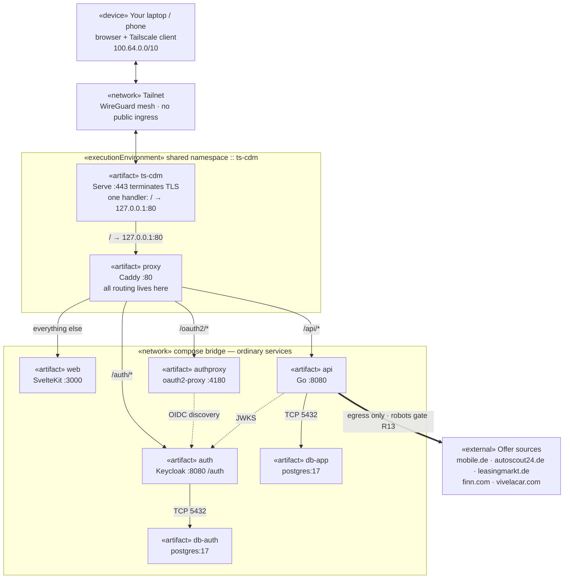
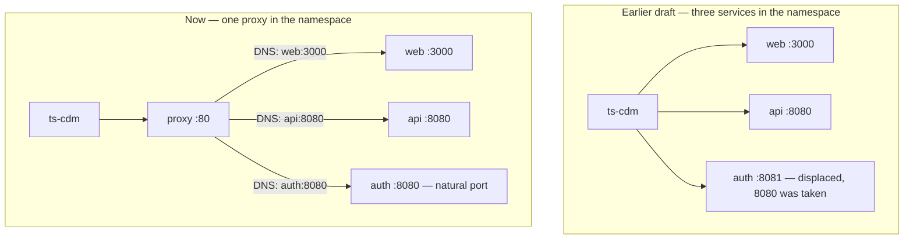
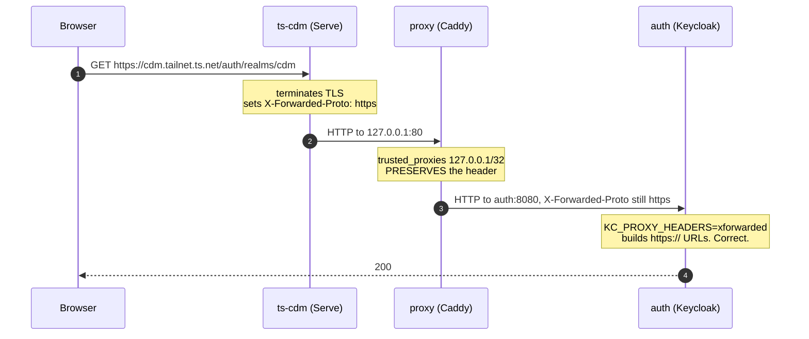
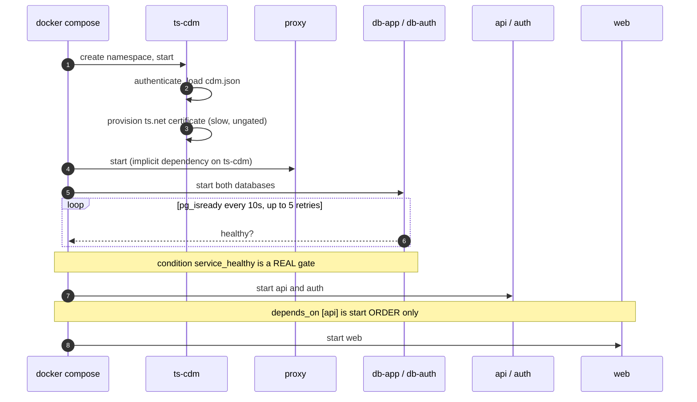
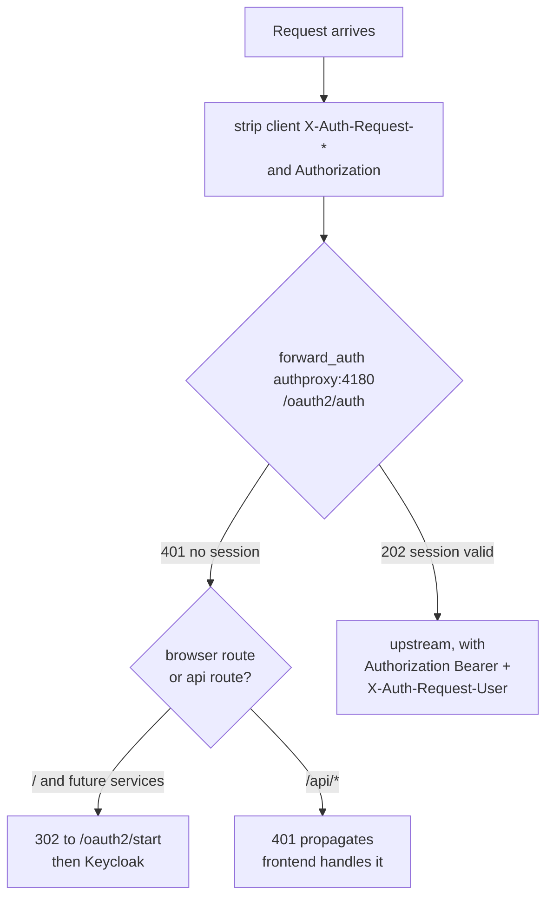
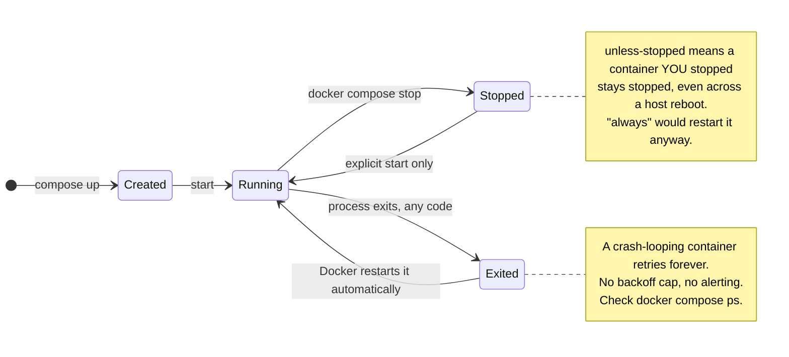
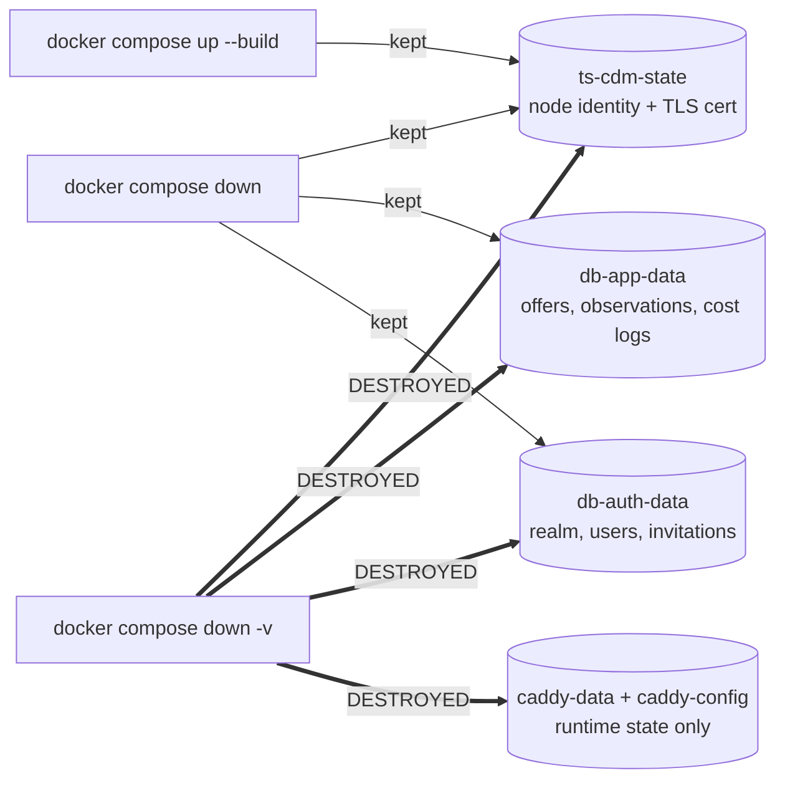

# The compose file, explained

Everything `compose.yaml` does and why, in UML and in prose. Companion to
`docs/architecture.md`, which covers the system design; this file covers the
**deployment artefact** — eight services, five volumes, and the one place a
network namespace is shared.

**Status: not runnable.** `./web` and `./api` do not exist, so `docker compose
up` fails at build. This is the agreed topology (ARC1), documented ahead of the
code rather than after it. The file itself is validated: `docker compose config`
parses and interpolates it cleanly.

> **The diagrams below are Mermaid**, which renders in GitHub, GitLab, and VS
> Code with a Mermaid extension — but **not** in a plain text or file viewer,
> where you will see the fenced source instead. Rendered version:
> <https://claude.ai/code/artifact/c2a74b64-3c77-4adb-b2de-b349c10c91a5>

---

## 1. Service inventory

| Service | Image / build | Role | Network | Port |
|---|---|---|---|---|
| `ts-cdm` | `tailscale/tailscale` | Joins the tailnet, runs Serve, terminates TLS | owns a namespace | 443 |
| `proxy` | `caddy:2-alpine` | Reverse proxy. **The only namespace sharer** | shares `ts-cdm` | 80 |
| `web` | build `./web` | SvelteKit frontend | bridge | 3000 |
| `api` | build `./api` | Go backend | bridge | 8080 |
| `auth` | `keycloak:26.4` | Identity provider, served at `/auth` | bridge | 8080 |
| `authproxy` | `oauth2-proxy:v7.7.1` | Auth gateway. **Gates every request** (D32) | bridge | 4180 |
| `db-app` | `postgres:17-alpine` | Application data | bridge | 5432 |
| `db-auth` | `postgres:17-alpine` | Keycloak data | bridge | 5432 |

Five named volumes: `ts-cdm-state`, `caddy-data`, `caddy-config`,
`db-app-data`, `db-auth-data`.

**No service declares `ports:`** — verified against the resolved config, not
just the source. Nothing is published on a host interface, which is what makes
SEC1's "no known exposures" a structural claim rather than a matter of
configuration discipline.

Note `api` and `auth` both on 8080. They are separate containers on the bridge
network, so that is fine — and it is rather the point of the design.

---

## 2. Deployment diagram



One namespace boundary instead of four. Everything to the right of Caddy is an
ordinary compose service reached by DNS name.

---

## 3. Why one container still shares a namespace

**Tailscale Serve can only proxy to `127.0.0.1`.** That is a documented,
deliberate limitation ([tailscale#8751](https://github.com/tailscale/tailscale/issues/8751)),
not an oversight. So *something* has to sit inside the sidecar's network
namespace to receive the proxied traffic.

The design question is only ever *what*. An earlier draft put `web`, `api` and
`auth` in there. This one puts Caddy in there and nothing else.



| Property | Earlier draft | Now |
|---|---|---|
| Containers in the shared namespace | 3 | 1 |
| Port allocation | Hand-managed, flat, no enforcement | Each service keeps its natural port |
| Keycloak's port | 8081, displaced by `api` | 8080, its default |
| Adding a service | New namespace member, find a free port, edit `cdm.json` | One Caddyfile block |
| `cdm.json` | Edited on every routing change | Written once, never touched |
| SSO for a future service | Implement OIDC in that service | `import sso` |

**What has not changed:** the namespace trick is still load-bearing, and
"tidying" `proxy` onto ordinary bridge networking still breaks TLS in a way that
presents as a certificate problem. It is now one documented oddity in one place
rather than a pattern repeated across the file.

---

## 4. The header chain, which is where this goes wrong

Two proxies now sit in front of Keycloak. That is the one genuinely fragile part
of the arrangement and it is worth understanding before touching it.



Remove `trusted_proxies` from the Caddyfile and step 3 changes: Caddy stops
trusting the incoming header and overwrites it with `http`, because its own
connection from Serve is plain HTTP. Keycloak then builds `http://` redirect
URLs, the browser refuses to follow them from an HTTPS page, and login enters a
loop that looks nothing like a header problem.

**This is why `deploy/caddy/Caddyfile` is listed load-bearing under ARC1.**

---

## 5. Startup sequence



**Two dependency modes, deliberately different:**

- `api` and `auth` use `condition: service_healthy`. Compose blocks until
  `pg_isready` passes; Postgres is genuinely unusable before that and both would
  crash-loop on connection refused.
- `web` uses the bare list form. That is **start-order only** — Compose does not
  wait for `api` to serve anything. Fine for a frontend that renders a loading
  state; the moment `web` gains a boot-time call to `api`, this needs a
  healthcheck on `api` and a condition here.
- `proxy` needs no database dependency at all. Caddy starts, fails to reach a
  backend, and returns 502 until that backend is up — which is correct behaviour
  for a proxy rather than something to gate.

**The certificate is the slow step and nothing gates on it.** The stack reports
healthy roughly a minute before the hostname answers. Expected, not a failure.

---

## 6. Authentication at the ingress

Every request is gated here (D32). The application runs no OIDC flow of its own.



Two snippets, because a browser and an XHR need different failure behaviour:

| Snippet | Used by | On 401 |
|---|---|---|
| `(sso)` | `/`, and any future service | Redirect to Keycloak, return to the original URL |
| `(sso-api)` | `/api/*` | Propagate the 401 unchanged |

A 302 to a login page is correct for a navigation and wrong for a fetch, which
would receive an HTML form where it expected JSON.

### The one line that must not be removed

```caddyfile
(strip-identity) {
    request_header -X-Auth-Request-User
    request_header -X-Auth-Request-Email
    request_header -X-Auth-Request-Groups
    request_header -Authorization
}
```

Both snippets import this **before** calling oauth2-proxy. Without it a client
could send `X-Auth-Request-User: someone` and be believed. `copy_headers` then
re-adds those headers from the auth response, which is the only trustworthy
source.

### Why the API still verifies

`--set-authorization-header=true` makes oauth2-proxy return a Bearer token,
which Caddy passes upstream and `api` verifies for itself — signature, issuer,
audience, expiry.

The simplification would be to have `api` trust `X-Auth-Request-User` and skip
that. It was rejected because **every container on the compose bridge can reach
`api:8080` directly** — `db-app`, `authproxy`, any future service — and Caddy is
not in that path. Under header-trust, auth would rest on network topology, so
one stray `ports:` line or one compromised container would be a silent, total
bypass. Verifying a signature costs one flag.

Note the audience: the token is minted for the **forward-auth** client, so
`CDM_OIDC_AUDIENCE` is `cdm-forward-auth`.

### Never gated

`/auth/*`, because Keycloak *is* the authenticator and putting it behind itself
is an infinite loop. `/oauth2/*`, because those endpoints establish the session.
And `/api/healthz` (D33), liveness only — **expressed in the Caddyfile and
nowhere else.** An equivalent `--skip-auth-route` on oauth2-proxy was written
and removed: a second copy of one rule is free to drift out of step with the
first.

### Adding a service

```caddyfile
handle /grafana/* {
    import sso
    reverse_proxy grafana:3000
}
```

No namespace changes, no port arithmetic, no `cdm.json` edit, and no OIDC code
in the service.

---

## 7. Container lifecycle

Every service carries `restart: unless-stopped`.



---

## 8. Persistence



**`docker compose down -v` is a destructive data operation and CON1 applies** —
confirm before running it, locally included. It destroys every offer and its
entire price history, which **cannot be re-fetched retroactively** and is the
asset the system exists to accumulate; every account, invitation and realm
configuration; and the tailnet node identity, so the node re-registers as a
*new* device while the old one lingers in the admin console.

The database volumes are separate (D23) precisely so one can be reset without
the other: `docker volume rm cdm_db-app-data` clears application data and leaves
identity intact. The Caddy volumes hold nothing worth keeping — with
`auto_https off` there are no certificates in them.

---

## 9. Failure modes

| Symptom | Likely cause |
|---|---|
| Hostname does not resolve | MagicDNS not enabled, or the node has not finished registering |
| Certificate warning | HTTPS Certificates not enabled in the admin console |
| Node reappears as `cdm-1`, `cdm-2`… | `TS_STATE_DIR` not persisted, or an ephemeral auth key |
| **Infinite redirect at login** | `trusted_proxies` missing from the Caddyfile, **or** `KC_HOSTNAME` not exactly matching the external URL including path |
| 502 on everything | `proxy` is down, or Serve points somewhere other than `127.0.0.1:80` |
| 502 on one path only | That backend is down, or the Caddyfile names a service or port that does not exist |
| `api` crash-loops at boot | `db-app` healthcheck never passed — check `POSTGRES_APP_PASSWORD` |
| `authproxy` exits at boot | Bad `OAUTH2_PROXY_COOKIE_SECRET` — it must be exactly 16, 24 or 32 bytes |
| Compose refuses to start | A `:?` variable is unset. Intended — no fallback to a default secret |
| Token rejected by `api` | `CDM_OIDC_ISSUER` and `KC_HOSTNAME` disagree, usually by a trailing slash |

---

## 10. If you change one thing, check these

| Change | Also update |
|---|---|
| A service's port | Only the Caddyfile. Nothing else references it |
| Adding a service | One Caddyfile block. Add `import sso` if it cannot do its own auth |
| `hostname: cdm` | `KC_HOSTNAME`, both issuer variables, `--redirect-url` and `--whitelist-domain` on authproxy, and every Keycloak redirect URI |
| `KC_HTTP_RELATIVE_PATH` | The `/auth/*` handler, `KC_HOSTNAME`, both issuer variables |
| Removing `trusted_proxies` | Don't. See §4 |
| Adding `ports:` to anything | **SEC1.** Creates a known exposure; needs a stated reason and remediation before it counts as accepted |
| Enabling Tailscale Funnel | Same as above — Funnel publishes to the public internet and contradicts D14 |
| A service that cannot run under a sub-path | Give it its own Tailscale sidecar pointing back at this Caddy, rather than contorting the app |
